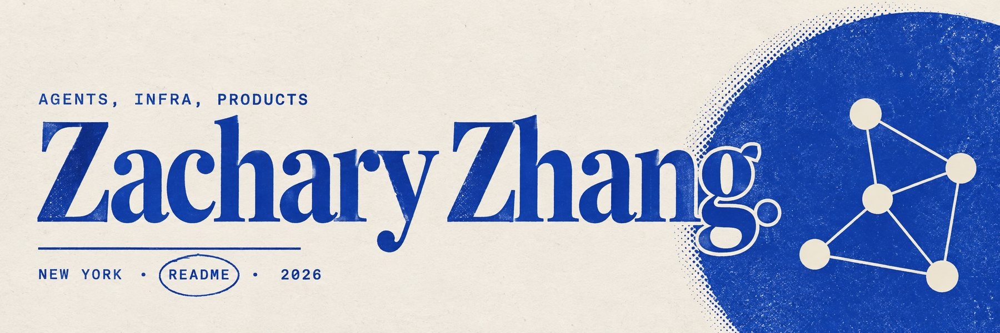
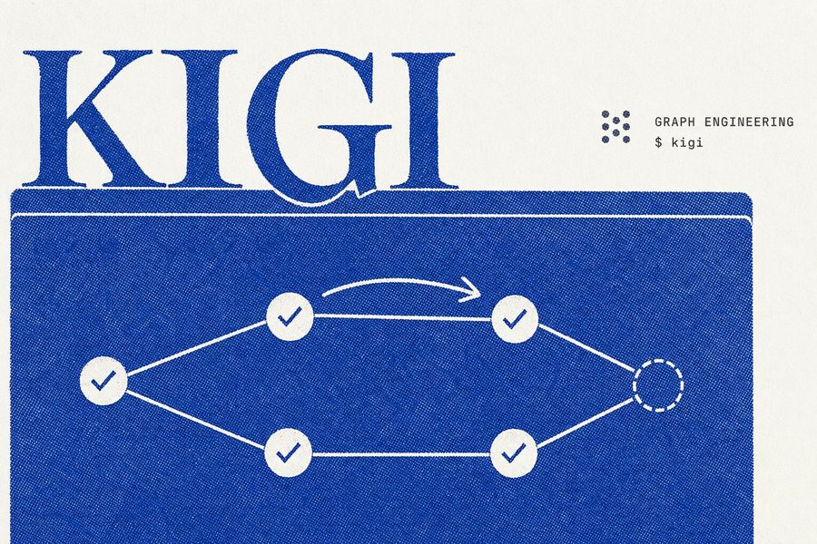
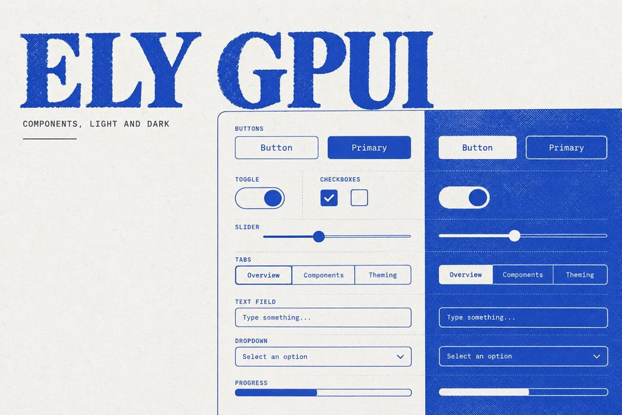
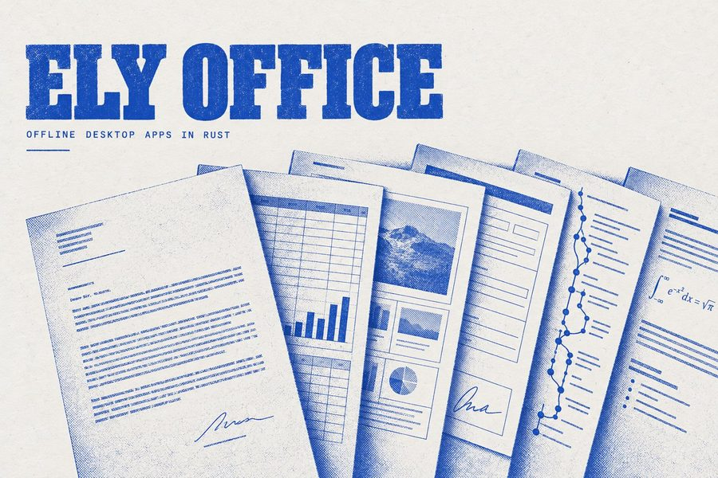
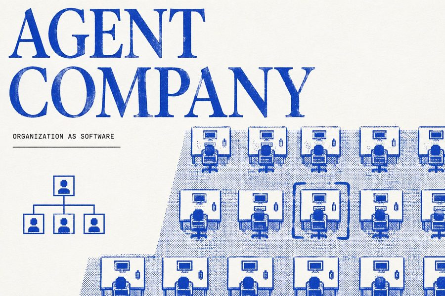
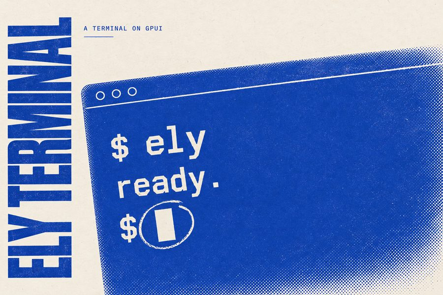
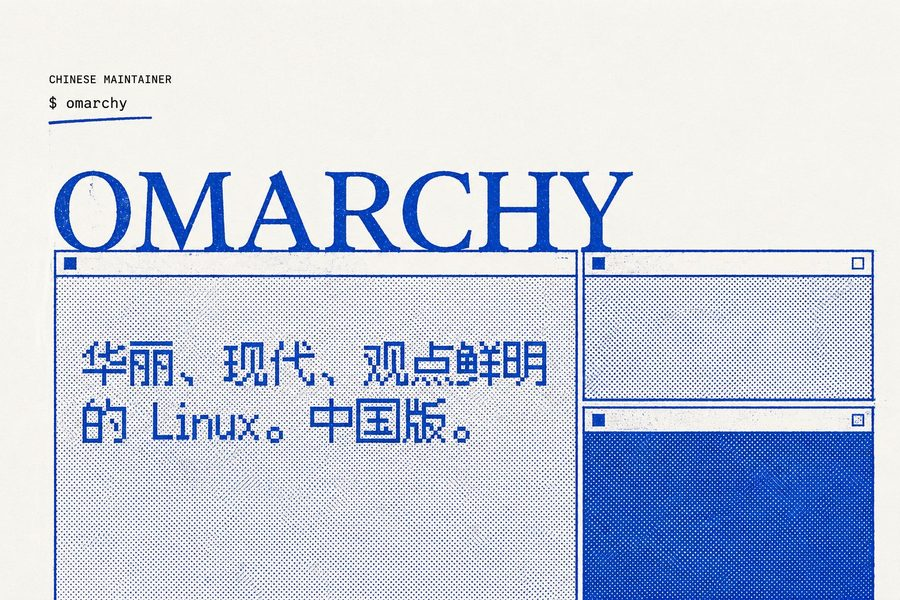
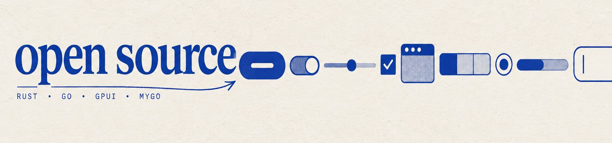

  <b>AI founder &nbsp;·&nbsp; product &amp; technology lead &nbsp;·&nbsp; New York</b>
   
  Nearly ten years shipping, six times from a blank page to market. I build AI agents, developer infrastructure, and native UI, mostly in Rust and Go.

  
  
  
  
  
  

 

## Selected work

<table>
  <tr>
    <td width="50%" valign="top">
      
       <b>Elydora</b> &nbsp;<code>2025–</code>
       Accountability infrastructure for autonomous agents. Every key action gets a signed, hash-chained record of what the agent did, when, and why.
       <a href="https://elydora.com">elydora.com</a> · <a href="https://github.com/Elydora-Infra">SDKs</a>
    </td>
    <td width="50%" valign="top">
      
       <b>Kigi CLI</b> &nbsp;<code>Rust</code> &nbsp;<!--stars:ELY-Open-Source/Kigi-CLI-->★ 2<!--/stars-->
       Open-source coding agent. A planner turns a goal into a dependency graph; workers build nodes in parallel git worktrees; verifiers check each node.
       <a href="https://kigicli.dev">kigicli.dev</a> · <a href="https://github.com/ELY-Open-Source/Kigi-CLI">source</a>
    </td>
  </tr>
  <tr>
    <td width="50%" valign="top">
      
       <b>Ely GPUI</b> &nbsp;<code>Rust · Wasm</code> &nbsp;<!--stars:ELY-Open-Source/Ely-GPUI-Components-->★ 22<!--/stars-->
       1,272 components for GPUI, the Rust framework behind Zed. Light and dark, and every one runs live in the browser.
       <a href="https://elygpui.com">elygpui.com</a> · <a href="https://github.com/ELY-Open-Source/Ely-GPUI-Components">source</a>
    </td>
    <td width="50%" valign="top">
      
       <b>Ely Office</b> &nbsp;<code>Rust · GPUI</code> &nbsp;<!--stars:ELY-Open-Source/ElyOffice-->★ 483<!--/stars-->
       Six offline desktop apps: documents, sheets, slides, PDF, Git, and Markdown. Opens Office files. No account, no cloud.
       <a href="https://office.elygpui.com">office.elygpui.com</a> · <a href="https://github.com/ELY-Open-Source/ElyOffice">source</a>
    </td>
  </tr>
  <tr>
    <td width="50%" valign="top">
      
       <b>Agent Company</b> &nbsp;<code>Electron</code> &nbsp;<!--stars:ELY-Open-Source/AgentCompany-->★ 3<!--/stars-->
       A desktop company of AI agents. Set a goal; a CEO agent builds departments, delegates, and reports back from a pixel office.
       <a href="https://agent-company.dev">agent-company.dev</a> · <a href="https://github.com/ELY-Open-Source/AgentCompany">source</a>
    </td>
    <td width="50%" valign="top">
      
       <b>ELY Terminal</b> &nbsp;<code>Rust · GPUI</code> &nbsp;<!--stars:ELY-Open-Source/ELYTerminal-->★ 36<!--/stars-->
       A terminal built on GPUI and the Ely components.
       <a href="https://github.com/ELY-Open-Source/ELYTerminal">source</a>
    </td>
  </tr>
  <tr>
    <td width="50%" valign="top">
      
       <b>MyGo UI</b> &nbsp;<code>Go · Wasm</code>
       Three component sets for MyGo native Go UI: court-gothic Mujica, 1,500-piece Crychic, and 16-bit pixel 8bit.
       <a href="https://github.com/ELY-Open-Source/MujicaUI">Mujica</a> · <a href="https://github.com/ELY-Open-Source/CrychicUI">Crychic</a> · <a href="https://github.com/ELY-Open-Source/8bitMyGoUI">8bit</a>
    </td>
    <td width="50%" valign="top">
      
       <b>Omarchy Linux</b> &nbsp;<code>Arch · Hyprland</code>
       Official Chinese maintainer for Omarchy. It began with OmarchyCN, which reached nearly ten thousand downloads in two days.
       <a href="https://omarchy.org">omarchy.org</a> · <a href="https://omarchycn.zacharyzhang.com">OmarchyCN</a>
    </td>
  </tr>
</table>

 

| Repository | What it is | Stack | Stars |
|:--|:--|:--|--:|
| [**ElyOffice**](https://github.com/ELY-Open-Source/ElyOffice) | Offline-first desktop office apps | Rust · GPUI | <!--stars:ELY-Open-Source/ElyOffice-->★ 483<!--/stars--> |
| [**OmaPhoto**](https://github.com/ELY-Open-Source/OmaPhoto) | Layered photo editor for Linux, a port of Compositor | C++ · Qt | <!--stars:ELY-Open-Source/OmaPhoto-->★ 4<!--/stars--> |
| [**ELYTerminal**](https://github.com/ELY-Open-Source/ELYTerminal) | A terminal on GPUI and Ely | Rust · GPUI | <!--stars:ELY-Open-Source/ELYTerminal-->★ 36<!--/stars--> |
| [**Ely-GPUI-Components**](https://github.com/ELY-Open-Source/Ely-GPUI-Components) | 1,272 GPUI components | Rust · Wasm | <!--stars:ELY-Open-Source/Ely-GPUI-Components-->★ 22<!--/stars--> |
| [**Kigi-CLI**](https://github.com/ELY-Open-Source/Kigi-CLI) | Graph-planned multi-agent coding CLI | Rust | <!--stars:ELY-Open-Source/Kigi-CLI-->★ 2<!--/stars--> |
| [**AgentCompany**](https://github.com/ELY-Open-Source/AgentCompany) | A company of AI agents on your desktop | TypeScript | <!--stars:ELY-Open-Source/AgentCompany-->★ 3<!--/stars--> |
| [**CrychicUI**](https://github.com/ELY-Open-Source/CrychicUI) | 1,500 components in MyGo's own look | Go | <!--stars:ELY-Open-Source/CrychicUI-->★ 1<!--/stars--> |
| [**MujicaUI**](https://github.com/ELY-Open-Source/MujicaUI) | Court-gothic components for MyGo | Go | <!--stars:ELY-Open-Source/MujicaUI-->★ 3<!--/stars--> |
| [**8bitMyGoUI**](https://github.com/ELY-Open-Source/8bitMyGoUI) | 16-bit pixel-art components, in the browser via Wasm | Go | <!--stars:ELY-Open-Source/8bitMyGoUI-->★ 2<!--/stars--> |
| [**Elydora SDKs**](https://github.com/Elydora-Infra) | [Go](https://github.com/Elydora-Infra/Elydora-Go-SDK) · [Node](https://github.com/Elydora-Infra/Elydora-Node-SDK) · [Python](https://github.com/Elydora-Infra/Elydora-Python-SDK) · [Open Source](https://github.com/Elydora-Infra/Elydora-Open-Source) | Go · JS · Py | |

 

## Now

| Where | Role |
|:--|:--|
| **GiraStyle AI** | Co-founder &amp; CTO. Consumer iOS app, enterprise web platform, architecture. |
| **Aedylon** | Technical partner &amp; CTO. AI ad production and delivery, in Rust. |
| **American Health Formulations** | AI applications and digital systems for a pharmaceutical maker. |
| **KOIN** | Co-founder &amp; CTO since 2020. AI investing for the US market, SEC/FINRA qualified. |
| **Omarchy Linux** | Chinese-region maintainer on the official team. |

 

  <code>PRINTED IN ONE INK</code> &nbsp;·&nbsp; cobalt <code>#2148B8</code> on paper <code>#F5F1E8</code> &nbsp;·&nbsp; <a href="https://zacharyzhang.com">zacharyzhang.com</a>

